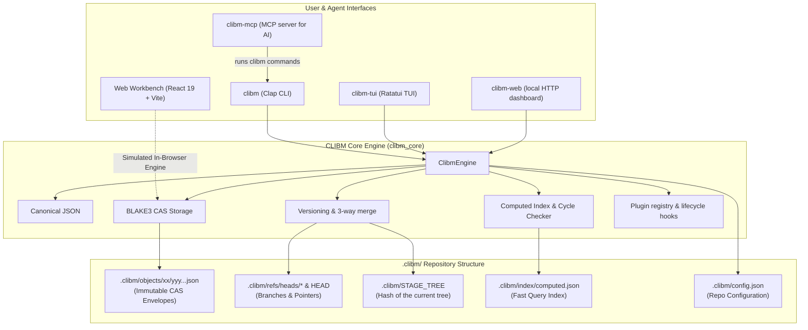

# CLIBM — CLI-Based Manager & Content-Addressable Storage Engine

[](https://www.rust-lang.org)
[](https://react.dev)
[](https://www.typescriptlang.org)
[](https://vitejs.dev)
[](https://tailwindcss.com)
[](https://github.com/BLAKE3-team/BLAKE3)
[](LICENSE.txt)
[]()

> **CLIBM** is a local-first, Git-style project manager for the terminal, written in **Rust**:
> tasks live in a content-addressed store inside your project, every change is versioned, and
> AI agents can work on the board through the Model Context Protocol. A **React 19 +
> TypeScript** web workbench simulates the CLI in the browser.

---

## Table of Contents

- [Overview](#overview)
- [Key Architectural Highlights](#key-architectural-highlights)
- [System Architecture](#system-architecture)
- [Monorepo Structure](#monorepo-structure)
- [Quick Install](#quick-install)
- [Quick Start — Native Rust CLI](#quick-start--native-rust-cli)
- [Quick Start — Web Workbench & Simulator](#quick-start--web-workbench--simulator)
- [Plugin Ecosystem (`CLIBM_PLUGIN_CONTRACT_V1`)](#plugin-ecosystem-clibm_plugin_contract_v1)
- [Complete CLI Command Reference](#complete-cli-command-reference)
- [CAS Object Specification & Directory Layout](#cas-object-specification--directory-layout)
- [Updating CLIBM](#updating-clibm)
- [Uninstalling CLIBM](#uninstalling-clibm)
- [Development](#development)
- [License](#license)

---

## Overview

CLIBM is project management for developers, teams and AI agents without a database server:

1. **No database**: everything is plain files in `.clibm/` next to your code, fully offline.
2. **Content-addressed storage**: every workspace, project, board, task, tree and commit is
   stored as canonical JSON and named by its 256-bit BLAKE3 hash.
3. **Git-style versioning**: commits, branches, checkout, structural diffs and three-way
   merges. Unchanged tasks are shared between branches and commits.
4. **Dependencies and workflow rules**: tasks can depend on other tasks; cycles are refused,
   and moves respect dependencies and column WIP limits.
5. **Headless core**: the `clibm_core` library holds all the logic; the CLI, the terminal UI,
   the web dashboard and the MCP server all use it.
6. **Plugins**: standalone binaries that you run on demand or that react to lifecycle hooks
   (and may veto actions).

---

## Key Architectural Highlights

- **Canonical JSON (`canonical.rs`)**: object keys are sorted recursively (JCS-style, RFC 8785
  ordering) before hashing, so the same content always produces the same BLAKE3 hash on every
  platform.
- **4-field immutable envelope** for every stored object:
  ```json
  {
    "Type": "task",
    "Version": "0.1.0",
    "Hash": "7f83b1657ff1fc53b92dc18148a1d65dfc2d4b1fa3d677284addd200126d9069",
    "Payload": { ... }
  }
  ```
- **Sharded storage**: `.clibm/objects/<2-hex-shard>/<62-hex-rest>.json`.
- **Computed index (`index.rs`)**: `.clibm/index/computed.json` for fast lookups by column,
  priority, tag and assignee, plus dependency-cycle detection.
- **Automatic commits**: with `auto_commit = true` (default) every change becomes a commit.
- **Stable task numbers**: a deleted task's number is never reused, even across branches
  (same-ID tasks added on two branches are renumbered on merge).
- **AI integration**: the `clibm-mcp` plugin implements the Model Context Protocol
  (`2024-11-05`) over stdio and a local HTTP endpoint.

---

## System Architecture



---

## Monorepo Structure

```
CLIBM/
├── package.json               # Web workbench (React 19, Tailwind v4, Vite)
├── src/                       # Web workbench & in-browser simulator
│   ├── App.tsx, components/   # Views (terminal, Kanban, CAS inspector, plugins, ...)
│   ├── core/                  # TypeScript simulation of the CLIBM engine
│   └── rust/                  # Rust source registry & in-browser ZIP builder
└── rust-clibm/                # Native Rust implementation (Cargo workspace)
    ├── Cargo.toml             # Workspace + `clibm` package (binary `clibm`, library `clibm_core`)
    ├── install.* / uninstall.* / update.*   # Installers (PowerShell and Bash)
    ├── scripts/               # Shared PATH, ledger, build and registry helpers (env-path)
    ├── src/
    │   ├── canonical.rs       # Canonical JSON & hashing
    │   ├── cas.rs             # Object store, refs, branch-name validation, fsck
    │   ├── engine.rs          # ClibmEngine: tasks, workspaces, status, rules, hooks
    │   ├── versioning.rs      # Commits, log, diff, 3-way merge
    │   ├── index.rs           # Computed index & cycle detection
    │   ├── plugin.rs          # Plugin registry, install/uninstall, hooks
    │   ├── plugin_sdk.rs      # Helper for writing plugins on clibm_core
    │   ├── install.rs         # ~/.clibm/install-config.json
    │   ├── update.rs          # `clibm update`
    │   ├── cli.rs, main.rs    # The `clibm` command line
    │   └── models.rs          # Domain types
    ├── tests/                 # End-to-end CLI tests
    └── plugins/
        ├── clibm-mcp/         # MCP server for AI agents
        ├── clibm-tui/         # Terminal Kanban board
        ├── clibm-web/         # Local web dashboard
        ├── clibm-dep-audit/   # Dependency audit (cycles, blockers, critical path)
        ├── clibm-export-md/   # Markdown report
        ├── clibm-workflow-lint/ # Kanban workflow checks
        └── plugin-template/   # Starter for your own plugins
```

---

## Quick Install

Requires the Rust toolchain (`cargo` 1.75+, from [rustup.rs](https://rustup.rs)): the
installers build CLIBM on your machine.

### Linux, macOS, WSL2
```bash
curl -fsSL https://raw.githubusercontent.com/FelipeVandevelde/CLIBM/refs/heads/main/rust-clibm/install.sh | bash
```

### Windows (native, PowerShell)
```powershell
iex (irm https://raw.githubusercontent.com/FelipeVandevelde/CLIBM/refs/heads/main/rust-clibm/install.ps1)
```

## Quick Uninstall

### Linux, macOS, WSL2
```bash
curl -fsSL https://raw.githubusercontent.com/FelipeVandevelde/CLIBM/refs/heads/main/rust-clibm/uninstall.sh | bash
```

### Windows (native, PowerShell)
```powershell
iex (irm https://raw.githubusercontent.com/FelipeVandevelde/CLIBM/refs/heads/main/rust-clibm/uninstall.ps1)
```

---

## Quick Start — Native Rust CLI

### Installing

The one-liners above ask a few questions (profile, language, automatic commits, install
folder, PATH) and build CLIBM with `cargo install --git` from the official repository.
To build another repository or branch, set `CLIBM_GIT_URL` / `CLIBM_GIT_REF` first.

Non-interactive:

```powershell
# Windows: download, then run with flags
Invoke-WebRequest -Uri "https://raw.githubusercontent.com/FelipeVandevelde/CLIBM/refs/heads/main/rust-clibm/install.ps1" -OutFile install.ps1
.\install.ps1 -Yes                               # pure core
.\install.ps1 -Profile with-defaults -Yes        # + dep-audit, export-md, workflow-lint
```

```bash
curl -fsSL https://raw.githubusercontent.com/FelipeVandevelde/CLIBM/refs/heads/main/rust-clibm/install.sh | bash -s -- -y
curl -fsSL https://raw.githubusercontent.com/FelipeVandevelde/CLIBM/refs/heads/main/rust-clibm/install.sh | bash -s -- --with-defaults -y
```

From a clone, the installers build the local sources:

```bash
cd rust-clibm
./install.sh                      # or: ./install.sh -y --no-modify-path
.\install.ps1                     # or: .\install.ps1 -Yes -NoModifyPath
```

The installer records its choices and where the build came from (repository, branch, commit,
version) in `~/.clibm/install-config.json`. `clibm init` uses them as defaults and
`clibm update` uses them to update.

### User PATH and the ownership ledger

CLIBM never needs administrator rights and never touches the system PATH:

- **Windows**: the install folder (default `~\.clibm-bin`) is added to the *user* `Path`
  (`HKCU:\Environment`, kept as `REG_EXPAND_SZ`) and a `WM_SETTINGCHANGE` broadcast is sent.
- **Linux / macOS**: an idempotent `# >>> clibm PATH: <dir> >>>` block is added to your shell
  profile.
- **`~/.clibm/path-ledger`** records which component added each folder. Uninstalling removes a
  PATH entry only when nothing else needs it and CLIBM added it.
- Opt out with `-NoModifyPath` / `--no-modify-path`.

Open a new terminal after installing.

### First steps in a project

```bash
mkdir my-app && cd my-app
clibm init --workspace "frontend" --code APP --name "Client Application"

clibm task add "Design Token System" -p high -c done --tags ui,design     # APP-101
clibm task add "Responsive Layout" -p critical -c todo --depends-on 101   # APP-102
clibm task add "Dark Mode Switcher" --depends-on 102                       # APP-103

clibm board show
clibm status

clibm board move 102 in-progress     # 102, APP-102, app-102 or a hash prefix all work
clibm task edit 103 --assignee ana --add-tag ui
clibm fsck
```

`clibm init` refuses to run where a repository already exists.

---

## Quick Start — Web Workbench & Simulator

The React app simulates the CLI in the browser (no Rust needed) and lets you browse the Rust
sources and download them as ZIP files.

```bash
npm install
npm run dev      # http://localhost:3000
npm run build    # static build in dist/
```

- Interactive terminal, Kanban board, CAS inspector, commit graph and diff viewer.
- Live BLAKE3 playground.
- ZIP downloads of the core, the whole workspace and each plugin (plain UTF-8, so the shell
  scripts run as-is). Plugins that use the core library (`clibm-web`, `clibm-tui` and the
  analysis plugins) build from the workspace ZIP.

The simulator is a teaching tool: its behaviour can lag behind the Rust CLI.

---

## Plugin Ecosystem (`CLIBM_PLUGIN_CONTRACT_V1`)

### Official plugins

| Plugin | What it does |
|---|---|
| [`clibm-mcp`](rust-clibm/plugins/clibm-mcp/README.md) | MCP server: lets AI agents read and manage the project |
| [`clibm-tui`](rust-clibm/plugins/clibm-tui/README.md) | Terminal Kanban board |
| [`clibm-web`](rust-clibm/plugins/clibm-web/README.md) | Local web dashboard (127.0.0.1, token-protected writes) |
| [`clibm-dep-audit`](rust-clibm/plugins/clibm-dep-audit/README.md) | Dependency audit: cycles, blockers, critical path |
| [`clibm-export-md`](rust-clibm/plugins/clibm-export-md/README.md) | Markdown report (also written on `clibm export`) |
| [`clibm-workflow-lint`](rust-clibm/plugins/clibm-workflow-lint/README.md) | WIP limits, assignees, open dependencies, overdue tasks |
| [`plugin-template`](rust-clibm/plugins/plugin-template/README.md) | Starter for your own plugin |

### Installing, running and removing plugins

```bash
clibm plugin install mcp                 # official name; builds from your clone or from GitHub
clibm plugin install tui
clibm plugin install ./path/to/plugin    # any plugin folder with a Cargo.toml
clibm plugin list
clibm plugin run dep-audit
clibm plugin run web -- --port 7878
clibm plugin disable workflow-lint       # for this project only
clibm plugin uninstall mcp               # stops it, deletes the binary, removes it from the registry
```

Each plugin also has its own `install.ps1` / `install.sh` / `uninstall.*` scripts and
one-liners (see its README).

### Where plugins are registered

- **`~/.clibm/plugins/registry.json`** lists the installed plugins. Each entry is the plugin's
  own manifest (`<plugin> --manifest`): hooks, MCP tools and the executable path.
- **`.clibm/plugins/registry.json`** in a project only holds `{"name", "enabled"}` overrides.
  A project can switch plugins on or off but never point CLIBM at an executable, so a cloned
  repository cannot make CLIBM run its own programs.
- Entries whose binary disappeared are removed automatically.

### Lifecycle hooks

| Event | When | Can block |
|---|---|---|
| `pre-commit` / `post-commit` | around every commit (automatic or `clibm commit`) | `pre-commit` |
| `pre-move` / `on-task-move` | around `clibm board move` | `pre-move` |
| `on-task-depend` | after `clibm task depend` | no |
| `on-workspace-switch` | after `clibm workspace switch` | no |
| `on-export` | after `clibm export` | no |

A plugin that answers `ok: false` (or fails, or exceeds `hook_timeout_secs`, default 10) on a
`pre-*` event blocks the action and nothing is written. Skip hooks once with
`clibm --no-hooks …` or `CLIBM_NO_HOOKS=1`.

### Plugin JSON contract

CLIBM sends one request on the plugin's stdin:

```json
{
  "contract": "CLIBM_PLUGIN_CONTRACT_V1",
  "event": "pre-move",
  "tree_hash": "a1b2c3d4e5f6...",
  "args": [],
  "context": { "task_id": "APP-102", "board_id": "BRD-01", "from": "todo", "to": "in-progress", "force": false }
}
```

`event` is `manual-run` for `clibm plugin run`; `context` is only sent with hooks. The plugin
answers on stdout:

```json
{ "ok": true, "output": "[dep-audit] Cycles: none" }
```

### Scaffolding a plugin

```bash
clibm plugin new sprint-velocity --description "Tracks sprint velocity" --hooks post-commit,on-task-move
cd plugins/clibm-sprint-velocity
./install.sh
clibm plugin run sprint-velocity
```

---

## Complete CLI Command Reference

Global flags: `--json` (machine-readable output) and `--no-hooks` (skip plugin hooks).

**Task references** — wherever a task is expected you can write the full ID (`APP-101`, any
case), the number (`101`, the active project's task first) or a prefix of at least 4
characters of the task's current object hash (as shown by `clibm board show`; it changes
whenever the task changes).

### Repository & setup

```bash
clibm init [--workspace <WS>] [--code <CODE>] [--name <NAME>] [--lang <en|pt-BR|es>] [--auto-commit <bool>] [--install-path <DIR>] [--with-defaults]
clibm status                    # branch, HEAD, uncommitted changes, active project, counts per column
clibm fsck                      # verify every object's BLAKE3 hash (exit code 1 on corruption)
clibm cat-object <HASH_PREFIX>  # print a stored object
clibm export [-o <FILE>]        # whole repository as a portable JSON bundle
```

### Workspaces

```bash
clibm workspace list
clibm workspace create <NAME> [-c <CODE>] [-d <DESCRIPTION>]
clibm workspace switch [<ID_OR_NAME>]            # without a target: next workspace alphabetically
```

### Tasks & dependencies

```bash
clibm task list [--column <COL>] [--priority <PRIO>] [--tag <TAG>] [--all-workspaces]
clibm task add <TITLE> [-d <DESC>] [-p <PRIO>] [-c <COL>] [-a <ASSIGNEE>] [--due <DATE>] [--tags a,b] [--depends-on 101,102] [--force]
clibm task show <TASK>
clibm task edit <TASK> [--title …] [-d …] [-p …] [-a …] [--due …] [--tags a,b] [--add-tag t] [--remove-tag t]
clibm task delete <TASK> [--force]               # refuses while other tasks depend on it
clibm task comment <TASK> <MESSAGE> [-a <AUTHOR>]
clibm task depend <TASK> <DEPENDS_ON>            # cycles are refused
clibm task transfer <TASK> <WORKSPACE> [--copy]
clibm task history <TASK>
```

`task add` without `-p` uses `default_priority` from the config.

### Kanban board

```bash
clibm board show
clibm board move <TASK> <COLUMN> [--force]       # dependencies, WIP limits and required assignees apply
```

### Versioning, branching & merges

```bash
clibm commit -m <MESSAGE> [-a <AUTHOR>]          # does nothing when there is nothing to commit
clibm log [<REF>]
clibm branch [<NAME>]                            # list, or create at HEAD (names are validated)
clibm checkout <BRANCH_OR_COMMIT> [--force]      # refuses to discard uncommitted changes
clibm diff <FROM_REF> <TO_REF>
clibm merge <BRANCH> [--ours | --theirs] [-a <AUTHOR>]
```

`merge` is a three-way merge against the common ancestor: changes made on one side (including
deletions) are applied, and changes made differently on both sides are conflicts. Conflicts stop
the merge (nothing is changed) unless you pass `--ours` or `--theirs`. Tasks added on both
branches with the same ID are renumbered. When possible the merge fast-forwards.

### Plugins

```bash
clibm plugin list
clibm plugin install [<NAME_OR_PATH>] [--transport stdio|both|http]
clibm plugin run <NAME> [-- <ARGS>...]
clibm plugin new <NAME> [--description <TEXT>] [--hooks a,b]
clibm plugin enable <NAME> | clibm plugin disable <NAME>
clibm plugin uninstall <NAME>
```

### Configuration

```bash
clibm config show
clibm config get <KEY>
clibm config set <KEY> <VALUE>      # e.g. auto_commit false, hook_timeout_secs 20
clibm config reset
```

Keys: `auto_commit`, `author_name`, `author_email`, `default_priority`,
`enforce_dependencies`, `enforce_wip_limits`, `cross_workspace_dependencies`,
`hook_timeout_secs`, `language`, `install_profile`, `install_path`, `mcp_transport`,
`github_repo_url` (GitHub browser links are repaired), `update_branch`.

### Updating & uninstalling

```bash
clibm update [--check] [--plugins] [--repo <URL>] [--branch <NAME>] [--path <CLONE>]
clibm uninstall [--purge] [--yes]
```

---

## CAS Object Specification & Directory Layout

```
.clibm/
├── HEAD                         # "ref: refs/heads/main" or a commit hash (detached)
├── STAGE_TREE                   # hash of the current (staged) tree object
├── config.json                  # project configuration
├── index/
│   └── computed.json            # lookups by column, priority, tag, assignee; cycles
├── refs/heads/
│   ├── main                     # commit hash of branch 'main'
│   └── feature/login            # branch names may contain '/'
├── plugins/
│   └── registry.json            # per-project plugin on/off overrides
└── objects/
    └── 7f/83b1657ff1fc53b92dc18148a1d65dfc2d4b1fa3d677284addd200126d9069.json
```

Object types: `workspace`, `project`, `board` (columns, WIP limits, workflow rules), `task`,
`tree` (entity IDs → object hashes, plus per-project task counters) and `commit` (tree hash,
parents, author, time, message).

---

## Updating CLIBM

```bash
clibm update --check            # compare the installed build with the latest commit
clibm update                    # rebuild and replace clibm (works while it is running)
clibm update --plugins          # also rebuild every installed official plugin
clibm update --path ~/src/CLIBM # build from a local clone
```

`clibm update` builds from where CLIBM was installed (recorded by the installer), the
official repository otherwise. Inside a clone, `./update.sh` / `.\update.ps1` pull the latest
changes and update from the clone.

---

## Uninstalling CLIBM

```powershell
iex (irm https://raw.githubusercontent.com/FelipeVandevelde/CLIBM/refs/heads/main/rust-clibm/uninstall.ps1)
.\uninstall.ps1            # from a clone
.\uninstall.ps1 -Purge     # also delete the .clibm data in the current folder
```

```bash
curl -fsSL https://raw.githubusercontent.com/FelipeVandevelde/CLIBM/refs/heads/main/rust-clibm/uninstall.sh | bash
./uninstall.sh             # from a clone
./uninstall.sh --purge     # also delete the .clibm data in the current folder
```

`clibm uninstall` lists everything CLIBM installed (binaries, `~/.clibm`, PATH entries) with
the commands to remove it. `clibm uninstall --purge` deletes the current folder's `.clibm`
after asking for confirmation (or with `--yes`); it never deletes a repository found in a
parent folder.

---

## Development

```bash
cd rust-clibm
cargo build --workspace
cargo test --workspace                                   # unit + end-to-end tests
powershell -File scripts/sync-env-path.ps1 -Check        # shared installer helpers in sync
cd .. && npm run lint && npm run build                   # web workbench
```

After editing `rust-clibm/scripts/env-path.*`, run `scripts/sync-env-path.ps1` to copy the
helpers into every install/uninstall script.

---

## License

This project is licensed under the **MIT License** — see [LICENSE.txt](LICENSE.txt).

Copyright (c) 2026 Vandevelde
