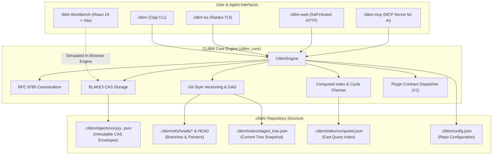

# CLIBM — CLI-Based Manager & Content-Addressable Storage Engine

[](https://www.rust-lang.org)
[](https://react.dev)
[](https://www.typescriptlang.org)
[](https://vitejs.dev)
[](https://tailwindcss.com)
[](https://github.com/BLAKE3-team/BLAKE3)
[](LICENSE.txt)
[]()

> **CLIBM** is a high-performance, local-first, modular CLI project management system and Content-Addressable Storage (CAS) engine written in **Rust**, accompanied by a rich **React 19 + TypeScript** interactive web workbench and simulator.

---

## Table of Contents

- [Overview](#overview)
- [Key Architectural Highlights](#key-architectural-highlights)
- [System Architecture](#system-architecture)
- [Monorepo Structure](#monorepo-structure)
- [Quick Start — Native Rust CLI](#quick-start--native-rust-cli)
  - [Prerequisites](#prerequisites)
  - [Quick Installation (Direct from GitHub)](#quick-installation-direct-from-github)
  - [Local Installation (From Cloned Repository)](#local-installation-from-cloned-repository)
  - [Non-Elevated User PATH & Reference-Counted Ledger](#non-elevated-user-path--reference-counted-ledger)
  - [First Steps in a Project](#first-steps-in-a-project)
- [Quick Start — Web Workbench & Simulator](#quick-start--web-workbench--simulator)
  - [Running the Web App](#running-the-web-app)
  - [Web Capabilities](#web-capabilities)
- [Plugin Ecosystem (`CLIBM_PLUGIN_CONTRACT_V1`)](#plugin-ecosystem-clibm_plugin_contract_v1)
  - [Official Plugins Overview](#official-plugins-overview)
  - [Installing & Running Plugins in Ongoing Projects](#installing--running-plugins-in-ongoing-projects)
  - [Scaffolding Custom Plugins](#scaffolding-custom-plugins)
  - [Plugin JSON Contract](#plugin-json-contract)
- [Complete CLI Command Reference](#complete-cli-command-reference)
- [CAS Object Specification & Directory Layout](#cas-object-specification--directory-layout)
- [Updating CLIBM](#updating-clibm)
- [Uninstalling CLIBM](#uninstalling-clibm)
- [License](#license)

---

## Overview

Traditional project management tools either rely on heavy external databases (PostgreSQL, SQLite), enforce proprietary cloud silos, or lack cryptographic integrity guarantees.

**CLIBM** fundamentally redesigns project management for developers, engineering teams, and autonomous AI agents:

1. **Zero External Databases**: Completely file-based and offline-first. No background database servers or drivers required.
2. **BLAKE3 Content-Addressable Storage (CAS)**: Every entity (`workspace`, `project`, `board`, `task`, `tree`, `commit`) is normalized via **RFC 8785 Canonical JSON** and addressed by its immutable 256-bit BLAKE3 hash.
3. **Git-Style Versioning & Branching**: True commit history, tree snapshots, branching, O(N) structural diffs, and two-parent merges. Unchanged tasks share disk space across branches.
4. **DAG Dependency Enforcement & Cycle Prevention**: Tasks declare blocking dependencies. Built-in DFS validation prevents circular dependencies and calculates critical-path blockers.
5. **Decoupled Architecture**: The core logic (`clibm_core`) is 100% headless. User interfaces—CLI, Ratatui TUI, self-hosted HTTP server, Model Context Protocol (MCP) server, and Web Workbench—interact through strictly decoupled APIs and contracts.
6. **Dual Ecosystem**: Native Rust binaries for your terminal workflows alongside an in-browser TypeScript implementation with an interactive GUI, visual Kanban board, CAS envelope inspector, and on-demand ZIP packager.

---

## Key Architectural Highlights

- **RFC 8785 Deterministic Canonical Serialization (`canonical.rs`)**: Lexicographically sorts all object keys recursively before hashing, ensuring byte-identical BLAKE3 hashes across Linux, Windows, and macOS regardless of serialization order.
- **4-Field Immutable Envelope**: Every object stored on disk adheres to:
  ```json
  {
    "Type": "task",
    "Version": "0.1.0",
    "Hash": "7f83b1657ff1fc53b92dc18148a1d65dfc2d4b1fa3d677284addd200126d9069",
    "Payload": { ... }
  }
  ```
- **Sharded File Storage**: Objects are stored in `.clibm/objects/<2-hex-shard>/<62-hex-rest>.json` to ensure high filesystem throughput even with tens of thousands of objects.
- **Computed Indices & Fast Lookups (`index.rs`)**: Maintains `.clibm/index/computed.json` for rapid filtering by assignee, priority, tag, or column without re-scanning object directories.
- **Automatic Per-Modification Commits**: Configurable auto-commit mechanism (`auto_commit` in `.clibm/config.json`) creates historical snapshots on every mutation while preserving manual branch and merge workflows.
- **AI Agent Integration**: The `clibm-mcp` plugin natively implements the Model Context Protocol (MCP 2024-11-05) over stdio and HTTP SSE, letting tools like Claude, Cursor, Windsurf, and local LLMs manage projects safely.

---

## System Architecture



---

## Monorepo Structure

```
CLIBM/
├── package.json               # Web companion dependencies (React 19, Tailwind v4, Vite)
├── vite.config.ts             # Vite build configuration
├── tsconfig.json              # TypeScript compilation setup
├── metadata.json              # Project identity & AI Studio manifest
├── LICENSE.txt                # MIT License
├── src/                       # Companion Web Application & Simulator
│   ├── App.tsx                # Main workbench shell & navigation
│   ├── components/            # UI components
│   │   ├── CasInspectorView.tsx      # Interactive CAS object explorer
│   │   ├── ConfigurationView.tsx     # Repo configuration editor
│   │   ├── DocumentationView.tsx     # Comprehensive searchable docs
│   │   ├── KanbanAndTasksView.tsx    # Visual drag-and-drop Kanban board
│   │   ├── PluginMarketplaceView.tsx # Standalone plugin installer & template generator
│   │   ├── RustPackageView.tsx       # Rust source code viewer & exporter
│   │   ├── ShowcaseView.tsx          # Interactive landing page & live BLAKE3 demo
│   │   ├── TerminalPane.tsx          # Embedded web terminal emulator
│   │   ├── TuiAndWebPluginsView.tsx  # TUI & Web plugin runners/emulators
│   │   └── VersioningAndDiffView.tsx # Commit log DAG and structural tree diff
│   ├── core/                  # Client-side TypeScript CLIBM engine
│   │   ├── blake3.ts          # Pure TypeScript BLAKE3 implementation
│   │   ├── clibmCore.ts       # Headless state manager & command executor
│   │   └── types.ts           # Schema models matching Rust structs
│   └── rust/                  # Rust source registry & in-memory ZIP builder
│       ├── rustSourceRegistry.ts
│       └── zipBuilder.ts
└── rust-clibm/                # Native Rust 2021 Implementation
    ├── Cargo.toml             # Cargo manifest (clibm bin + clibm_core lib)
    ├── install.sh / .ps1      # Non-elevated interactive core installer
    ├── uninstall.sh / .ps1    # Safe uninstaller with reference-counted PATH cleanup
    ├── update.sh / .ps1       # GitHub updater script
    ├── scripts/               # Shared user PATH and ledger management helpers
    │   ├── env-path.sh
    │   ├── env-path.ps1
    │   └── sync-env-path.ps1
    ├── src/                   # Core Rust sources
    │   ├── canonical.rs       # RFC 8785 canonical JSON sorting & serialization
    │   ├── cas.rs             # Content-Addressable Storage engine & BLAKE3 hasher
    │   ├── cli.rs             # Clap 4.5 subcommand and argument definitions
    │   ├── engine.rs          # High-level ClibmEngine business logic
    │   ├── index.rs           # Computed query indices & DFS cycle detection
    │   ├── lib.rs             # Decoupled clibm_core library entrypoint
    │   ├── main.rs            # Native CLI executable runner
    │   ├── models.rs          # Domain structs (Task, Board, Commit, Tree, etc.)
    │   ├── plugin.rs          # CLIBM_PLUGIN_CONTRACT_V1 runner & registry
    │   └── versioning.rs      # Commits, branching, checkout, tree diff, merge
    └── plugins/               # Official standalone plugin crates
        ├── clibm-dep-audit/   # DAG critical path & cycle auditor
        ├── clibm-docs/        # AI documentation & context teacher
        ├── clibm-export-md/   # Markdown sprint report exporter
        ├── clibm-mcp/         # Model Context Protocol (MCP) server for AI
        ├── clibm-tui/         # Ratatui + Crossterm interactive terminal UI
        ├── clibm-web/         # Self-hosted single-binary HTTP server & workbench
        ├── clibm-workflow-lint/# Kanban WIP limits & workflow linter
        └── plugin-template/   # Official boilerplate for custom plugins
```

---

## Quick Install

### Linux, macOS, WSL2
```bash
curl -fsSL https://raw.githubusercontent.com/FelipeVandevelde/CLIBM/refs/heads/main/rust-clibm/install.sh | bash
```

### Windows (native, PowerShell)
```powershell
iex (irm https://raw.githubusercontent.com/FelipeVandevelde/CLIBM/refs/heads/main/rust-clibm/install.ps1)
```

## Quick Uninstall

### Linux, macOS, WSL2
```bash
curl -fsSL https://raw.githubusercontent.com/FelipeVandevelde/CLIBM/refs/heads/main/rust-clibm/uninstall.sh | bash
```

### Windows (native, PowerShell)
```powershell
iex (irm https://raw.githubusercontent.com/FelipeVandevelde/CLIBM/refs/heads/main/rust-clibm/uninstall.ps1)
```

---

## Quick Start — Native Rust CLI

### Prerequisites

- **Rust toolchain** (`rustc` & `cargo` 1.75+): Install via [rustup.rs](https://rustup.rs).

### Quick Installation (Direct from GitHub)

You can install CLIBM directly via the raw GitHub installer without manually cloning the repository. The installer automatically fetches the required Rust sources into a temporary build workspace, compiles the release binary, registers your user `PATH`, and cleans up temporary files.

#### Windows (PowerShell)

Run the interactive one-liner in PowerShell:

```powershell
irm https://raw.githubusercontent.com/FelipeVandevelde/CLIBM/refs/heads/main/rust-clibm/install.ps1 | iex
```

Or download `install.ps1` and run it with custom flags (such as `-Yes`, `-Profile with-defaults`, or `-NoModifyPath`):

```powershell
Invoke-WebRequest -Uri "https://raw.githubusercontent.com/FelipeVandevelde/CLIBM/refs/heads/main/rust-clibm/install.ps1" -OutFile install.ps1
.\install.ps1
# Silent / non-interactive install (Pure Core):
.\install.ps1 -Yes
# Silent install including the 3 default plugins (dep-audit, export-md, workflow-lint):
.\install.ps1 -Profile with-defaults -Yes
```

#### Linux / macOS (Bash / Zsh)

Run the interactive installer directly from GitHub:

```bash
curl -fsSL https://raw.githubusercontent.com/FelipeVandevelde/CLIBM/refs/heads/main/rust-clibm/install.sh | bash
```

Or pass non-interactive flags:

```bash
# Silent install (Pure Core):
curl -fsSL https://raw.githubusercontent.com/FelipeVandevelde/CLIBM/refs/heads/main/rust-clibm/install.sh | bash -s -- -y

# Silent install including the 3 default plugins:
curl -fsSL https://raw.githubusercontent.com/FelipeVandevelde/CLIBM/refs/heads/main/rust-clibm/install.sh | bash -s -- --with-defaults -y
```

---

### Local Installation (From Cloned Repository)

When running `install.ps1` or `install.sh` from a local clone of the repository, the installer automatically detects the local `Cargo.toml` and `src/` tree and builds directly in-place.

#### Windows (PowerShell — Local)

```powershell
cd rust-clibm
.\install.ps1

# For silent / non-interactive installation without modifying PATH:
.\install.ps1 -Yes -NoModifyPath
```

#### Linux / macOS (Bash — Local)

```bash
cd rust-clibm
./install.sh

# For automated / non-interactive installations (e.g., CI/CD):
./install.sh -y --no-modify-path

# Or install directly via Cargo:
cargo install --path .
```

> **Tip:** Open a new terminal session (or run `source ~/.bashrc` / `source ~/.zshrc` on Linux/macOS) to load the updated `PATH`.

### Non-Elevated User PATH & Reference-Counted Ledger

CLIBM never touches system or machine-wide environment variables and **never requires administrator / root privileges**:

- **Windows (`install.ps1`)**: Queries `HKCU:\Environment` `Path` with `DoNotExpandEnvironmentNames`, appends the install folder (default: `~\.clibm-bin` or `~/.local/bin`), writes it back as `REG_EXPAND_SZ` to preserve `%USERPROFILE%`, and broadcasts a `WM_SETTINGCHANGE` message.
- **Linux / macOS (`install.sh`)**: Appends an idempotent block (`# >>> clibm PATH: <dir> >>>` ... `# <<< clibm PATH: <dir> <<<`) to user shell startup profiles (`~/.bashrc`, `~/.zshrc`, or `~/.profile`).
- **Reference-Counted Ownership Ledger (`~/.clibm/path-ledger`)**: Records which components added each directory. When uninstalling a plugin or tool, directory entries in `PATH` are only removed if no other CLIBM components claim ownership, and pre-existing user directories are strictly preserved.

### First Steps in a Project

```bash
# 1. Initialize a new CLIBM project repository
mkdir my-app && cd my-app
clibm init --workspace "frontend" --code "APP" --name "Client Application"

# 2. Add tasks with priorities, tags, and dependencies
clibm task add "Design Token System" -p high -c done --tags ui,design
clibm task add "Implement Responsive Layout" -p critical -c in-progress --depends-on APP-101 --tags ui,layout
clibm task add "Add Dark Mode Switcher" -p medium -c todo --depends-on APP-102 --tags ui

# 3. View the Kanban board in your terminal
clibm board show

# 4. Move a task to a new column (enforces dependency prerequisites)
clibm board move APP-102 review

# 5. Commit your state and inspect cryptographic integrity
clibm commit -m "Initialize project and layout tasks"
clibm fsck
```

---

## Quick Start — Web Workbench & Simulator

CLIBM includes an interactive web application built with **React 19**, **TypeScript**, and **Tailwind CSS v4**. It features an in-browser pure-TypeScript implementation of the BLAKE3 engine and `clibm_core`, enabling full exploration without installing Rust.

### Running the Web App

```bash
# From the project root
npm install
npm run dev
```

Visit `http://localhost:3000` in your browser.

To build the static distribution:

```bash
npm run build
```

### Web Capabilities

- **Interactive Web Terminal**: Run any `clibm` command directly in your browser with real-time feedback.
- **Visual Kanban Board**: Drag-and-drop tasks, edit details, assignees, priorities, and monitor column WIP limits.
- **CAS Envelope Inspector**: Browse `.clibm/objects/`, view raw RFC 8785 Canonical JSON payloads, and verify 256-bit BLAKE3 hashes on the fly.
- **Git-Style DAG Visualizer**: Explore commit trees, historical diffs, and branch switches graphically.
- **Live BLAKE3 Playground**: Enter arbitrary JSON fields to watch deterministic canonicalization and BLAKE3 hash computation in real time.
- **In-Browser ZIP Packaging**: Download standalone ZIP archives generated client-side:
  - `clibm-core-v0.1.0.zip` (Pure headless core engine + CLI, zero UI dependencies)
  - `clibm-v0.1.0-workspace.zip` (Full Cargo workspace including all plugins)
  - Individual plugin ZIPs
  - `clibm-web-standalone.html` (Single-file zero-dependency offline web workbench)

---

## Plugin Ecosystem (`CLIBM_PLUGIN_CONTRACT_V1`)

CLIBM provides a folder-scoped, contract-driven plugin architecture. Plugins are standalone Cargo crates that communicate through standardized JSON or direct crate linkage.

### Official Plugins Overview

| Plugin | Folder | Raw PowerShell Installer (`install.ps1`) | Description |
|---|---|---|---|
| **`clibm-mcp`** | `plugins/clibm-mcp` | [`install.ps1`](https://raw.githubusercontent.com/FelipeVandevelde/CLIBM/refs/heads/main/rust-clibm/plugins/clibm-mcp/install.ps1) | **Model Context Protocol (MCP)** server for AI assistants (Claude Desktop, Cursor, Windsurf). Supports stdio JSON-RPC 2.0 and HTTP SSE transports. |
| **`clibm-tui`** | `plugins/clibm-tui` | [`install.ps1`](https://raw.githubusercontent.com/FelipeVandevelde/CLIBM/refs/heads/main/rust-clibm/plugins/clibm-tui/install.ps1) | Interactive terminal UI powered by **Ratatui + Crossterm** with split-pane Kanban, CAS inspector, and commit creator. |
| **`clibm-web`** | `plugins/clibm-web` | [`install.ps1`](https://raw.githubusercontent.com/FelipeVandevelde/CLIBM/refs/heads/main/rust-clibm/plugins/clibm-web/install.ps1) | Self-hosted single-binary HTTP server (`tiny_http`) with an embedded monochromatic workbench (`ui.html`). |
| **`clibm-dep-audit`**| `plugins/clibm-dep-audit` | [`install.ps1`](https://raw.githubusercontent.com/FelipeVandevelde/CLIBM/refs/heads/main/rust-clibm/plugins/clibm-dep-audit/install.ps1) | Analyzes task dependency DAGs, flags cycle risks, and highlights critical-path blockers. |
| **`clibm-docs`** | `plugins/clibm-docs` | [`install.ps1`](https://raw.githubusercontent.com/FelipeVandevelde/CLIBM/refs/heads/main/rust-clibm/plugins/clibm-docs/install.ps1) | Context generator that teaches AI agents and developers how to interact with CLIBM repositories. |
| **`clibm-export-md`**| `plugins/clibm-export-md` | [`install.ps1`](https://raw.githubusercontent.com/FelipeVandevelde/CLIBM/refs/heads/main/rust-clibm/plugins/clibm-export-md/install.ps1) | Exports current project/sprint trees into portable, publication-ready Markdown tables. |
| **`clibm-workflow-lint`**| `plugins/clibm-workflow-lint` | [`install.ps1`](https://raw.githubusercontent.com/FelipeVandevelde/CLIBM/refs/heads/main/rust-clibm/plugins/clibm-workflow-lint/install.ps1) | Validates Kanban WIP column limits, unblocked dependencies, and workflow policies. |
| **`plugin-template`**| `plugins/plugin-template` | [`install.ps1`](https://raw.githubusercontent.com/FelipeVandevelde/CLIBM/refs/heads/main/rust-clibm/plugins/plugin-template/install.ps1) | Reference starter template for building custom CLIBM plugins in Rust. |

### Installing & Running Plugins in Ongoing Projects

Every standalone plugin supports **both** direct installation from its raw GitHub script and local folder installation.

#### Option A: Quick Plugin Installation via GitHub Raw Script

```powershell
# Windows PowerShell — Install any official plugin directly from GitHub:
irm https://raw.githubusercontent.com/FelipeVandevelde/CLIBM/refs/heads/main/rust-clibm/plugins/clibm-tui/install.ps1 | iex
irm https://raw.githubusercontent.com/FelipeVandevelde/CLIBM/refs/heads/main/rust-clibm/plugins/clibm-web/install.ps1 | iex
irm https://raw.githubusercontent.com/FelipeVandevelde/CLIBM/refs/heads/main/rust-clibm/plugins/clibm-mcp/install.ps1 | iex
irm https://raw.githubusercontent.com/FelipeVandevelde/CLIBM/refs/heads/main/rust-clibm/plugins/clibm-docs/install.ps1 | iex
irm https://raw.githubusercontent.com/FelipeVandevelde/CLIBM/refs/heads/main/rust-clibm/plugins/clibm-dep-audit/install.ps1 | iex
irm https://raw.githubusercontent.com/FelipeVandevelde/CLIBM/refs/heads/main/rust-clibm/plugins/clibm-export-md/install.ps1 | iex
irm https://raw.githubusercontent.com/FelipeVandevelde/CLIBM/refs/heads/main/rust-clibm/plugins/clibm-workflow-lint/install.ps1 | iex
```

```bash
# Linux / macOS — Install any official plugin directly from GitHub:
curl -fsSL https://raw.githubusercontent.com/FelipeVandevelde/CLIBM/refs/heads/main/rust-clibm/plugins/clibm-tui/install.sh | bash
curl -fsSL https://raw.githubusercontent.com/FelipeVandevelde/CLIBM/refs/heads/main/rust-clibm/plugins/clibm-web/install.sh | bash
curl -fsSL https://raw.githubusercontent.com/FelipeVandevelde/CLIBM/refs/heads/main/rust-clibm/plugins/clibm-mcp/install.sh | bash
```

```bash
# Or via the CLIBM CLI (fetches from GitHub automatically if not in a local clone):
clibm plugin install tui
clibm plugin install web
clibm plugin install mcp --transport both
```

#### Option B: Local Plugin Installation (From Cloned Repository)

Each plugin is self-contained. When working in a local repository clone, you can build and install it directly from its own folder:

```bash
# Example: Install the Ratatui TUI plugin locally
cd rust-clibm/plugins/clibm-tui
./install.sh            # On Windows: .\install.ps1

# Example: Install the Self-Hosted Web Server plugin locally
cd ../clibm-web
./install.sh            # On Windows: .\install.ps1
```

#### Running Installed Plugins

Once installed, navigate to **any ongoing CLIBM project directory** (containing `.clibm/`) and run:

```bash
cd ~/my-app

# List all recognized plugins
clibm plugin list

# Run via clibm plugin runner
clibm plugin run tui
clibm plugin run web -- --port 7878

# Or invoke the binaries directly from your PATH
clibm-tui
clibm-web --port 7878
```

### Scaffolding Custom Plugins

Generate a new standalone plugin crate using the built-in scaffolding command:

```bash
clibm plugin new sprint-velocity --description "Tracks sprint cycle times and velocity" --hooks pre-commit,on-task-move
```

Then build and install it:

```bash
cd plugins/clibm-sprint-velocity
./install.sh
clibm plugin run sprint-velocity
```

### Plugin JSON Contract

External binaries interact with CLIBM via `CLIBM_PLUGIN_CONTRACT_V1`. CLIBM streams a JSON request to the plugin's `stdin`:

```json
{
  "contract": "CLIBM_PLUGIN_CONTRACT_V1",
  "event": "pre-commit",
  "tree_hash": "a1b2c3d4e5f6...",
  "args": ["--strict"]
}
```

The plugin responds on `stdout`:

```json
{
  "ok": true,
  "output": "[dep-audit] Audited 14 tasks: 0 cycles detected. DAG healthy."
}
```

---

## Complete CLI Command Reference

All commands support the global `--json` flag to return structured JSON output suitable for scripts and AI tooling.

### Repository & Setup

```bash
clibm init [--workspace <WS>] [--code <PREFIX>] [--name <NAME>] [--lang <en|pt-BR|es>] [--auto-commit <bool>] [--with-defaults]
clibm status                    # Show current branch, commit HEAD, and staged changes
clibm fsck                      # Cryptographically verify all BLAKE3 object envelopes
clibm cat-object <HASH_PREFIX>  # Print raw canonical JSON object envelope from CAS
clibm export [--output <FILE>]  # Export entire repository CAS as portable JSON bundle
```

### Workspaces

```bash
clibm workspace list                           # List all workspaces in repo
clibm workspace create <NAME> [-c <CODE>]      # Create a new workspace
clibm workspace switch [<NAME_OR_ID>]          # Switch active workspace (cycles if omitted)
```

### Tasks & Dependencies

```bash
clibm task list [--column <COL>] [--priority <PRIO>] [--tag <TAG>] [--all-workspaces]
clibm task add <TITLE> [-d <DESC>] [-p <PRIO>] [-c <COL>] [-a <ASSIGNEE>] [--due <DATE>] [--tags <T1,T2>] [--depends-on <ID1,ID2>]
clibm task show <TASK_ID>                      # Show full task metadata and comment thread
clibm task comment <TASK_ID> <MESSAGE>         # Add a comment to a task
clibm task depend <TASK_ID> <DEPENDS_ON_ID>    # Add a blocking dependency
clibm task transfer <TASK_ID> <WORKSPACE> [--copy] # Transfer or copy a task to another workspace
clibm task history <TASK_ID>                   # Trace individual task changes across commits
```

### Kanban Board

```bash
clibm board show                               # Render terminal ASCII Kanban board
clibm board move <TASK_ID> <COLUMN> [--force]  # Move task to column (checks dependencies & WIP)
```

### Versioning, Branching & Merges

```bash
clibm commit -m <MESSAGE> [-a <AUTHOR>]        # Commit staged tree snapshot
clibm log [<REF>]                              # View commit history DAG
clibm branch [<NAME>]                          # List branches or create a new branch
clibm checkout <TARGET>                        # Switch branch or checkout commit hash
clibm diff <FROM_REF> <TO_REF>                 # Structural diff between two branches/commits
clibm merge <BRANCH> [-a <AUTHOR>]             # Merge target branch into current HEAD
```

### Plugins & Tools

```bash
clibm plugin list                              # List registered and installed plugins
clibm plugin install [<PATH>] [--transport <T>]# Install plugin from local folder
clibm plugin run <NAME> [-- <ARGS>...]         # Run an installed plugin in active project
clibm plugin new <NAME> [--hooks <HOOKS>]      # Scaffold a new plugin crate
clibm plugin enable <NAME>                     # Enable a registered plugin
clibm plugin disable <NAME>                    # Disable a registered plugin
```

### Configuration

```bash
clibm config show                              # Display all .clibm/config.json settings
clibm config get <KEY>                         # Read single configuration key
clibm config set <KEY> <VALUE>                 # Update configuration value
clibm config reset                             # Reset configuration to defaults
```

---

## CAS Object Specification & Directory Layout

### The `.clibm` Project Directory

Inside any CLIBM project:

```
.clibm/
├── HEAD                         # Active branch ref ("ref: refs/heads/main") or commit hash
├── config.json                  # Project config (workspace ID, auto_commit, language)
├── index/
│   ├── staged_tree.json         # Current uncommitted TreeSnapshotPayload mapping
│   └── computed.json            # Fast query indices (by column, priority, tag)
├── refs/
│   └── heads/
│       ├── main                 # 64-char BLAKE3 commit hash for 'main'
│       └── feat-xyz             # 64-char BLAKE3 commit hash for feature branch
└── objects/                     # Sharded Content-Addressable Storage
    ├── 7f/
    │   └── 83b1657ff1fc53b92dc18148a1d65dfc2d4b1fa3d677284addd200126d9069.json
    └── a1/
        └── b2c3d4e5f6...json
```

### Object Types

1. **`workspace`**: Top-level organization container grouping projects.
2. **`project`**: Project metadata, identifier prefixes (e.g. `CLIBM-`), and default board link.
3. **`board`**: Ordered columns (`todo`, `in-progress`, `review`, `done`), column WIP limits, and policy flags.
4. **`task`**: Title, description, priority (`low`, `medium`, `high`, `critical`), column, assignee, tags, comments, and blocking dependencies (`depends_on`).
5. **`tree`**: Lightweight mapping of entity IDs to immutable BLAKE3 object hashes representing the complete project state at an instant in time.
6. **`commit`**: Commit metadata (author, message, timestamp, parents array) pointing to a root `tree` hash.

---

## Updating CLIBM

CLIBM can check and install updates directly from GitHub:

```bash
# Check if an update is available without installing:
clibm update --check

# Pull and install the latest version (including plugins):
clibm update --plugins

# Or use standalone updater scripts:
./update.sh --plugins        # Linux / macOS
.\update.ps1 -Plugins        # Windows PowerShell
```

---

## Uninstalling CLIBM

To completely remove CLIBM, use the **Quick Uninstall** one-liners (no manual folder deletion required):

### Windows (native, PowerShell)
```powershell
iex (irm https://raw.githubusercontent.com/FelipeVandevelde/CLIBM/refs/heads/main/rust-clibm/uninstall.ps1)
# Or from cloned repository:
.\uninstall.ps1
# To also purge local .clibm/ repository data:
.\uninstall.ps1 -Purge
```

### Linux, macOS, WSL2
```bash
curl -fsSL https://raw.githubusercontent.com/FelipeVandevelde/CLIBM/refs/heads/main/rust-clibm/uninstall.sh | bash
# Or from cloned repository:
./uninstall.sh
# To also purge local .clibm/ repository data:
./uninstall.sh --purge
```

Running `clibm uninstall` from inside the CLI also inspects your installed components and presents these exact commands.

---

## License

This project is licensed under the **MIT License** — see the [LICENSE.txt](LICENSE.txt) file for details.

Copyright (c) 2026 Vandevelde

